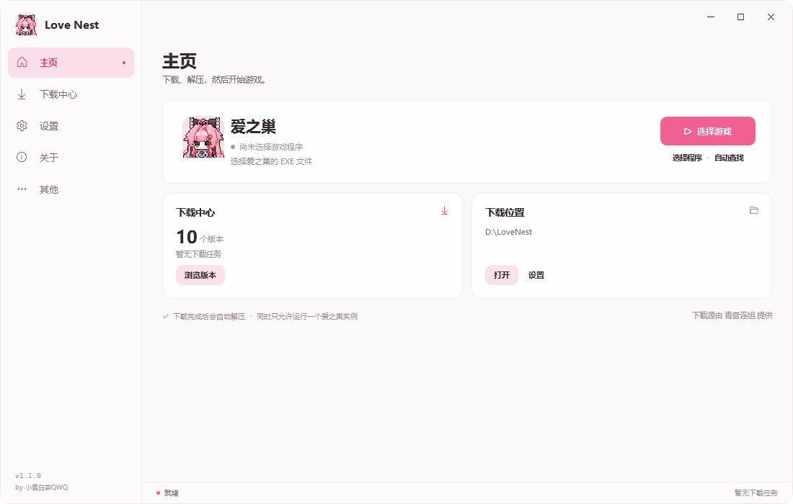
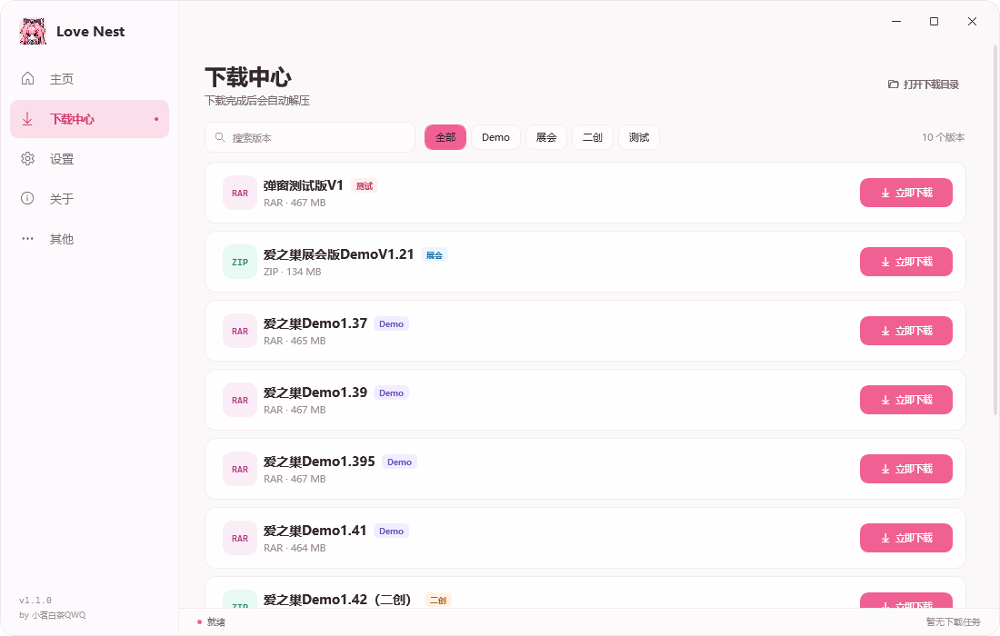

# Love Nest Launcher

爱之巢（Love Nest）玩家自制的下载启动器，使用 **C# / .NET 8 / WPF** 编写。界面保持简洁，采用可开关的亚克力透明背景(有BUG，不要使用)。

当前版本：**v1.1.0**



## 功能

- 内置爱之巢下载源，一键下载 10 个版本
- 支持断点续传、暂停 / 继续 / 取消、下载队列和并发数设置
- **下载完成后自动解压**，ZIP 内置解压，RAR 使用 7-Zip / WinRAR
- **直接从启动器启动游戏**，自动识别解压目录中的游戏程序，也可以手动选择 EXE
- **单实例保护**：同一时间只允许启动一个爱之巢
- **亚克力透明背景**：在设置中开关，关闭后使用纯色背景；系统不支持时会自动回退
- 支持导入自定义 TXT 下载源、恢复内置下载源
- 单文件 EXE 发布，无需安装 .NET 运行时



## 环境

- Windows 10 / Windows 11（x64）
- 运行发行版：无需安装 .NET 运行时
- 构建源码：.NET 8 SDK 或更新版本

## 构建

```powershell
dotnet build .\LoveNestLauncher.sln -c Release
```

也可以运行：

```powershell
.\build.ps1
```

## 发布单文件 EXE

```powershell
.\publish.ps1
```

输出：

```text
dist\Love Nest Launcher.exe
```

## 使用

1. 打开 `Love Nest Launcher.exe`。
2. 在「下载中心」选择版本并点击「立即下载」。
3. 下载完成后会自动解压；如果识别到游戏程序，主页会显示「启动游戏」。
4. 如果未识别到游戏，在「设置 → 游戏程序」中手动选择游戏 EXE。
5. 游戏运行期间再次点击会切换到游戏窗口，不会重复启动。

### 设置说明

- 下载位置、自动解压和并发数修改后，点击「保存下载设置」。
- 游戏路径和亚克力外观会立即保存。
- 自动解压 RAR 需要电脑中安装 7-Zip 或 WinRAR；ZIP 使用启动器内置解压。

### 下载源格式

TXT 每行一个版本，名称和下载地址之间至少两个空格：

```text
爱之巢Demo1.52    http://example.com/demo.rar
```

在「其他 → 下载源」中点击「导入 TXT」即可替换下载源。

### 数据目录

默认位置：

```text
%LOCALAPPDATA%\LoveNestLauncher
```

包含 `settings.json`、自定义 `download-sources.txt` 和 `launcher.log`。

便携模式：在 EXE 同目录新建空文件 `portable.flag`，数据会保存到 `data\` 子目录。

## 项目结构

```text
src/LoveNestLauncher/
  Assets/            应用图标与内置下载源
  Common/            路径、日志、格式化和通用 UI 工具
  Models/            设置、下载和游戏数据模型
  Services/          下载、解压、游戏启动、亚克力、下载源
  Themes/            WPF 主题与控件样式
  ViewModels/        主界面和下载项视图模型
  Views/             页面与自定义对话框
tools/EngineSmokeTest/  下载、配置、解压和游戏启动冒烟测试
```

运行测试：

```powershell
dotnet run --project .\tools\EngineSmokeTest\EngineSmokeTest.csproj -c Debug
```

## 致谢

- **作者 / 开发**：小茗白茶QWQ
- **设计思路**：Drunk耀爵
- **下载源提供**：青音连旭

## 说明

Love Nest Launcher 是玩家自制的版本下载工具，与游戏官方及 PCL 开发团队均无隶属关系。游戏及相关内容的版权归原作者所有。界面布局参考 PCL 的信息组织方式，所有界面素材与代码均为本项目独立实现。

Copyright © 2026 小茗白茶QWQ
